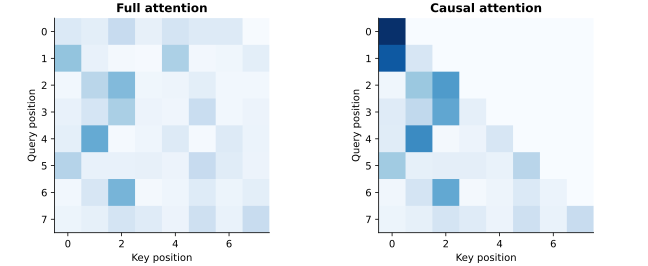

# Transformer Language Lab

**Inspect attention, verify causality, and trace tensors through a language-model stack.**

An educational PyTorch laboratory covering scaled dot-product attention,
sinusoidal position encodings, causal Transformer blocks and vocabulary logits.
Reusable modules sit alongside the original sequence of experiments.



## Implemented components

- Scaled dot-product attention with optional future-token masking.
- Sinusoidal positional encodings.
- Residual self-attention/feed-forward decoder blocks with layer normalization.
- A stacked causal self-attention model that consumes pre-embedded tokens.
- Small synthetic optimization experiments and tokenization comparisons.

## Run

```bash
pip install -r requirements.txt
python examples/inspect_attention.py
python -m unittest discover -s tests
```

```python
import torch
from models import DecoderOnlyTransformer
model = DecoderOnlyTransformer(32, 4, 64, 2, vocab_size=100).eval()
logits = model(torch.randn(8, 2, 32))
assert logits.shape == (8, 2, 100)
```

## Correctness and interpretation

The public version removes an unmasked cross-attention path from the original
decoder experiment. Tests verify that altering future inputs cannot change
earlier logits. Standalone attention is also checked for normalized rows and
zero probability on future tokens.

`DecoderOnlyTransformer` expects embedded input; callers provide token embeddings
and positional information. The notebook's `SimpleLLM` is a tokenwise toy baseline
without contextual attention. Its synthetic loss curves do not measure language
understanding. No trained large language model or benchmark score is claimed.

See [PROVENANCE.md](PROVENANCE.md) and [VALIDATION.md](VALIDATION.md).
